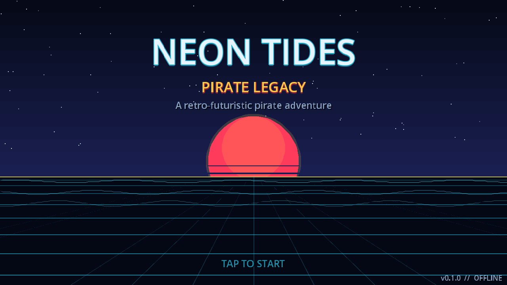
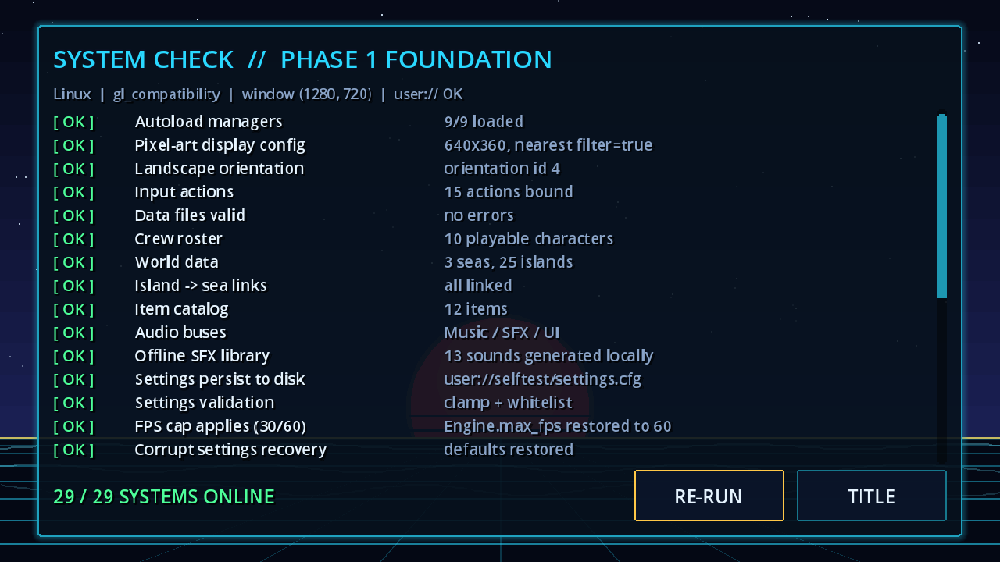

# Neon Tides: Pirate Legacy

An **offline** retro-futuristic pixel-art pirate action RPG for **Android**, built with **Godot 4.3+ / GDScript**.

> **IP note.** This is an *original* game in the anime-pirate-adventure genre. It doesn't use
> the names, characters, ships, places or art of any existing franchise. All content
> (crew, islands, items) is data-driven in `data/*.json`.

| Splash | On-device system check |
|---|---|
|  |  |

(Real frames rendered by Godot from this project.)

---

## Status: Phase 1 (Project Foundation) ✅ complete and verified

| Phase | Scope | Status |
|---|---|---|
| 1 | Project config, Android/pixel settings, folder architecture, global managers, save system | **Done (34/34 tests pass)** |
| 2 | Main menu, New Game / Continue, character selection | Next |
| 3 | Player movement, jump/attack, virtual joystick + buttons, camera, collision | — |
| 4 | Hitboxes, enemies, skills, bosses | — |
| 5 | First island, NPCs, quests, ship sailing, island transitions | — |
| 6 | Inventory, equipment, leveling, fruit powers, Will (Haki-style) system | — |
| 7 | Save/load UI (the backend already exists) | — |
| 8 | Android control layout editor, performance, APK | — |
| 9 | Full test pass | — |

### What Phase 1 actually does

| System | File | Verified behaviour |
|---|---|---|
| **EventBus** | `scripts/managers/event_bus.gd` | Global decoupled signals |
| **Settings** | `scripts/managers/settings_manager.gd` | `user://settings.cfg`; every value clamped or whitelisted; a corrupt file falls back to defaults; 30/60 FPS cap; vsync |
| **AudioManager** | `scripts/managers/audio_manager.gd` | Music/SFX/UI buses, pooled SFX players, music crossfade, **13 procedurally generated offline SFX** (drop `assets/audio/sfx/<id>.ogg` to replace any of them) |
| **DataRegistry** | `scripts/managers/data_registry.gd` | Loads and validates `data/**.json` (10 crew, 3 seas, 25 islands, 12 items); catches duplicate IDs and missing fields |
| **SaveManager** | `scripts/save_system/save_manager.gd` | Autosave slot + 3 manual slots, SHA-256 checksum, atomic write (tmp → verify → rotate backup), automatic backup restore, version check and migration hook, slot metadata, "Continue" target |
| **GameManager** | `scripts/managers/game_manager.gd` | New game, load/save, type-safe merge for old saves, EXP curve, multi-level-up, derived stats, gold, play time |
| **SceneManager** | `scripts/managers/scene_manager.gd` | Fade transitions with threaded loading, global neon theme, FPS overlay |
| **InputConfig** | `scripts/managers/input_config.gd` | 15 actions (move, jump, attack, dodge, block, skill 1–3, ultimate, interact, pause, back) with keyboard + gamepad bindings |
| **Platform** | `scripts/android/platform_bridge.gd` | Android back-button handler stack; autosave on app pause, focus loss or close; keeps the screen awake |

There is **no networking code anywhere**, and the Android preset has the `INTERNET` permission turned off (a test enforces this).

---

## Project settings (`project.godot`)

- Internal resolution **640×360**, stretch `canvas_items`, aspect `expand` (fills any phone aspect ratio)
- **Nearest-neighbor** texture filter, 2D transform and vertex pixel snapping
- Orientation **sensor landscape**; `quit_on_go_back=false` (back is handled in code)
- Renderer **GL Compatibility** (widest Android GPU support, low battery use)
- ETC2/ASTC texture compression enabled (needed for Android export)
- Autoload order matters: `EventBus → Settings → AudioManager → DataRegistry → SaveManager → GameManager → SceneManager → InputConfig → Platform`

## Scene trees

**`scenes/main/SplashScreen.tscn`** (`scripts/main/splash_screen.gd`)
```
SplashScreen (Control, full rect)
├── Backdrop (Control + neon_backdrop.gd)      animated sky, sun, sea grid, waves
├── TitleBox (VBoxContainer, top 42%)
│   ├── %Title     (Label)
│   ├── %Subtitle  (Label)
│   └── %Tagline   (Label)
├── %TapLabel      (Label, bottom center, blinking)
└── %VersionLabel  (Label, bottom right)
```
Advances on tap, click or `ui_accept`, or after 4 s, to `NEXT_SCENE`. In Phase 2 that becomes `MainMenu.tscn`.

**`scenes/main/BootCheck.tscn`** (`scripts/main/boot_check.gd`)
```
BootCheck (Control)
├── Backdrop (Control + neon_backdrop.gd)
└── Panel (PanelContainer)
    └── VBox
        ├── %Header, %Info (Label)
        ├── Scroll (ScrollContainer) └── %Results (VBoxContainer)   rows built in code
        └── Footer (HBox) ── %Summary (Label), %RerunButton, %TitleButton
```
This screen runs `SystemCheck` on the device itself, so storage, saving and audio get verified on real Android hardware.

---

## Folder structure

```
assets/      characters enemies bosses environments islands ships effects icons audio/{music,sfx} fonts
scenes/      main menus characters combat enemies bosses islands ships ui quests
scripts/     managers player combat enemies bosses inventory quests dialogue save_system android ui main debug
resources/   items skills characters quests dialogue
data/        characters enemies items islands quests      (JSON content)
tests/       headless test runner (excluded from export)
```

## Save format

`user://saves/slot_N.json` (slot 0 = autosave, slots 1–3 = manual) and `slot_N.bak.json`:
```json
{ "magic": "NEONTIDES", "version": 1, "saved_at": "...", "saved_at_unix": 0,
  "meta": { "character_name": "...", "level": 1, "island_name": "...", "gold": 100, "play_time_sec": 0 },
  "checksum": "<sha256 of payload>", "payload": "<game state as JSON string>" }
```

---

## Running

1. Install **Godot 4.3+** (standard build, not .NET).
2. Open `project.godot` in the editor and press **F5**.
   Desktop keys: WASD/arrows move, Space jump, J attack, L dodge, Q block, U/I/O skills, R ultimate, E interact, P pause, Esc back.

### Tests (headless)
```bash
godot --headless --path . --import
```
```bash
godot --headless --path . res://tests/TestRunner.tscn
```
The runner exits with code 0 only if all checks pass. Some `ERROR`/`WARNING` lines are expected because the tests feed bad input on purpose (an unknown character, a tampered save, slot 42).

## Exporting the Android APK

1. **Editor → Manage Export Templates → Download** (must match your Godot version).
2. Install **JDK 17** and the **Android SDK** (platform-tools, build-tools 34, platform 34). The easiest route is Android Studio.
3. **Editor Settings → Export → Android**: set the *Java SDK Path* and *Android SDK Path*. A debug keystore is created automatically.
4. **Project → Export → Android** (the preset is already in `export_presets.cfg`):
   arm64-v8a and armeabi-v7a, immersive mode on, `INTERNET` off, `data/*.json` included, `tests/*` excluded.
5. Click **Export Project** to produce `build/android/NeonTides.apk`, or use **Remote Debug** (one-click deploy) with a USB-connected phone that has developer mode on.
6. For a release build: create a keystore and set it under *Keystore → Release* in the preset. Keep it out of git (it's already in `.gitignore`).

On first launch the phone should show **"29 / 29 SYSTEMS ONLINE"** on the BootCheck screen. (The headless runner adds 5 project-file checks, for 34 in total.)

## Asset pipeline (for upcoming phases)

- Sprites: PNG, import preset **2D Pixel** (filter off, mipmaps off). One sheet per character, uniform cell size (planned 48×48 for the crew, 64×64 for bosses), with rows for idle 8 / walk 8 / run 8 / jump 6 / attack 8 / special 12 / hurt 4 / death 8 / victory 8 frames. These are built into `SpriteFrames` resources in `resources/characters/`.
- Audio: music as **OGG Vorbis**, loop enabled, in `assets/audio/music/`. SFX as OGG or WAV in `assets/audio/sfx/<id>.ogg`; these automatically replace the procedural placeholder with the same id.
- Font: drop an OFL-licensed pixel font into `assets/fonts/` and it gets wired into `NeonTheme` in Phase 2.
